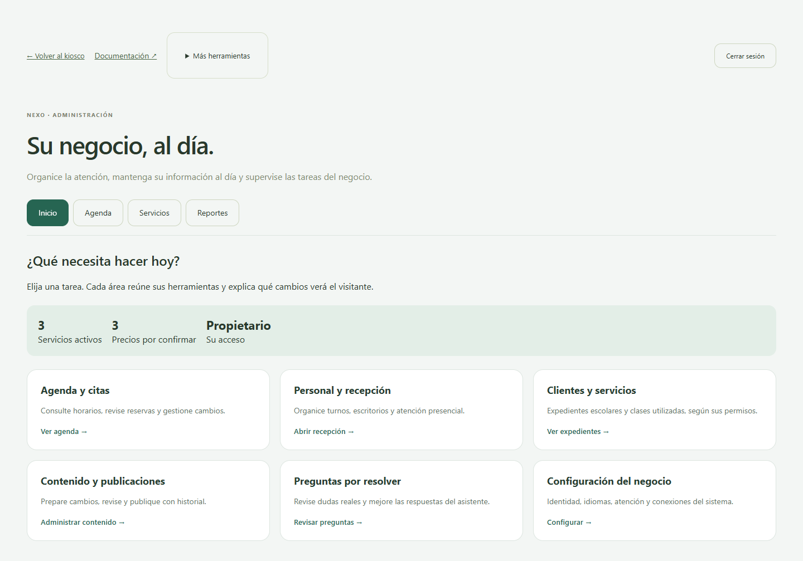
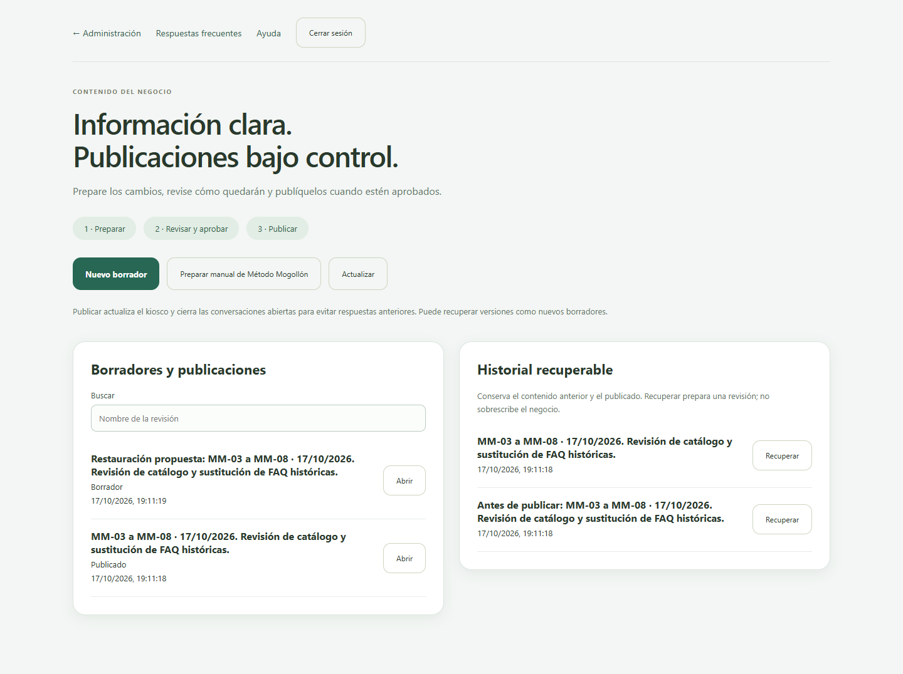

# Administración, publicaciones y componentes

Nexo 0.41.0 · 17 de octubre de 2026.

## Un punto de entrada

Entre por **Administración**. La portada reúne agenda, personal y recepción, expedientes escolares, contenido, preguntas por resolver y configuración. Las pestañas Inicio, Agenda, Servicios y Reportes evitan mostrar todos los formularios simultáneamente. «Más herramientas» conserva accesos secundarios. Los permisos se comprueban en el servidor; ocultar un enlace no concede ni revoca acceso.

En teléfono las tarjetas se apilan y los botones mantienen su tamaño. La interfaz administrativa admite desplazamiento: no intenta comprimir expedientes y formularios largos dentro de una sola pantalla de kiosco.

## Preparar y publicar contenido

1. Abra **Contenido y publicaciones** (`/publications`). Propietario y gerente pueden trabajar aquí.
2. Pulse **Nuevo borrador** para copiar el contenido vigente, o **Preparar manual de Método Mogollón** para generar la propuesta conservadora de los manuales de octubre. Esta última sustituye la base de FAQ completa dentro del borrador; revise su contenido antes de publicar.
3. Ponga una referencia o motivo. Elija cada servicio y complete descripción, precio, requisitos, horarios y componentes. Un precio vacío significa **por confirmar**; cero significa gratuito.
4. Edite las preguntas equivalentes, categoría, respuesta y estado mediante formularios. Una respuesta nueva nace pausada. En un negocio con conocimiento de texto propio se utiliza el editor de texto, sin obligarlo a adoptar el formato escolar.
5. Pulse **Guardar borrador**. Revise el resumen de diferencias. El kiosco aún conserva el contenido anterior.
6. Pulse **Aprobar revisión guardada** y después **Publicar revisión aprobada**. Cada acción solicita confirmación. Se cierran conversaciones existentes para que el siguiente visitante use el catálogo nuevo.
7. Si necesita recuperar contenido, use **Historial recuperable → Recuperar**. Se crea otro borrador: revisar, aprobar y publicar son pasos separados. No se restauran ni eliminan expedientes o reservas.

Una modificación posterior revoca la aprobación. Si otra persona cambia el catálogo, las FAQ o el perfil, la publicación se bloquea para evitar sobrescribir ese trabajo. Cree una revisión del estado vigente y reaplique sus cambios.

### Estados comerciales

| Estado | Efecto |
|---|---|
| Disponible según agenda y requisitos | Puede reservarse si la agenda está configurada y tiene disponibilidad. |
| Solo información | Se explica el servicio; la API impide una nueva reserva autónoma. |
| Retirado | No se ofrece en el catálogo público. |

El editor anterior de Servicios y el editor directo de FAQ siguen disponibles por compatibilidad y **guardan inmediatamente**. Para revisión y recuperación conjunta use Contenido y publicaciones. Su uso concurrente invalida un borrador anterior. No existe todavía aprobación obligatoria por dos personas ni editor separado de traducciones por idioma; los nuevos textos comerciales necesitan revisión lingüística.

## Componentes de paquetes

Cada componente tiene nombre, cantidad, servicio asociado opcional e importe asignado opcional (total del componente, en centavos). La suma de importes definidos no puede superar el precio conocido del paquete. La asociación al tipo de clase permite distinguir clases de materiales u otros servicios.

En **Expedientes → Servicios y clases**, una asignación nueva conserva la versión y los componentes del catálogo. Cambiar un paquete posteriormente no cambia esa instantánea.

Abra **Componentes del paquete · seguimiento**:

- El personal de oficina puede registrar unidades entregadas con una referencia verificable.
- No se puede superar la cantidad pendiente; repetir la misma solicitud no duplica la entrega.
- Gerencia puede revertir una entrega con motivo. Se conserva el registro y se recuperan sus unidades.
- Las clases asociadas se contabilizan únicamente desde **Clases realizadas**. No se descuentan dos veces como entrega de componente.
- El instructor solo ve expedientes asignados y progreso; no recibe importes privados ni el historial de entregas de oficina.
- Las asignaciones anteriores sin instantánea no reciben componentes retrospectivamente. Revise esos casos con gerencia.

Registrar «apoyo para cita» no significa que el DMV haya confirmado una cita. Este seguimiento tampoco acredita pagos. Los plazos comerciales de adicionales, descuentos y créditos no se aplican automáticamente.

## Conversación y recepción

El perfil escolar incorpora orientación breve sobre permiso, preparación, opciones de clases y cambios del Road Test en español, inglés y francés. Solo se activa con contenido marcado como la revisión aprobada del manual; el perfil general no ejecuta esos procesos. Se conserva contexto temporal del permiso y experiencia. La agenda existente sigue siendo responsable de la disponibilidad real y confirmación de reservas.

Al abrir atención presencial, se propone la categoría y el nombre del servicio actual. El visitante puede corregirlos antes de solicitar turno. No se transmite la transcripción completa ni se abre un expediente desde el chat.

## Pendientes y límites

La coordinación simultánea de profesor y vehículo necesita confirmar cómo se comparten los vehículos. La orientación sobre Road Test no cambia citas oficiales. Faltan decisiones comerciales y revisión normativa de los manuales; las condiciones inciertas se mantienen pendientes. No hay pagos en línea, telefonía ni SMS.

La clave del piloto permanece en `.env` (en el VPS, el archivo de entorno protegido del servicio), mediante `PILOT_PRIVATE_ENABLED` y `PILOT_PASSWORD`. No aparece en el catálogo ni en los borradores. [Acceso del piloto](53-configurar-acceso-piloto.md).

Vea el [estado de las fases](64-fases-multinegocio.md), el [recorrido del código](codigo/publicaciones.md) y la [validación de esta entrega](66-entrega-0410.md).
